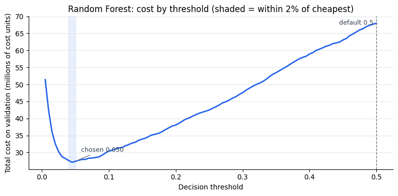
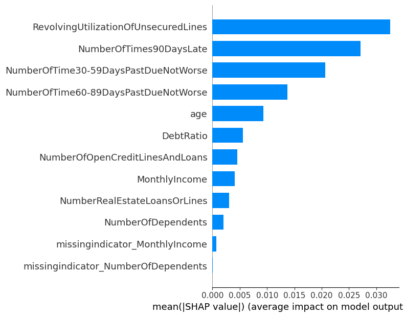
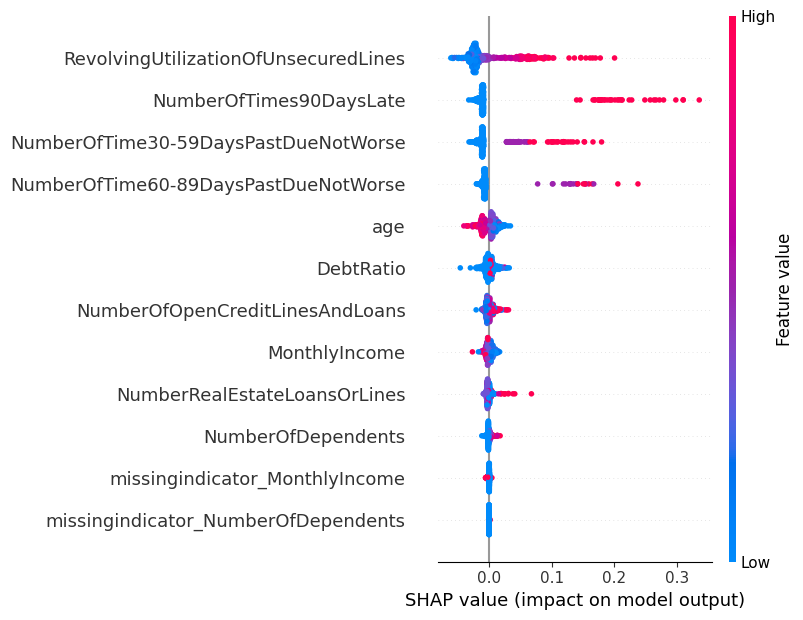
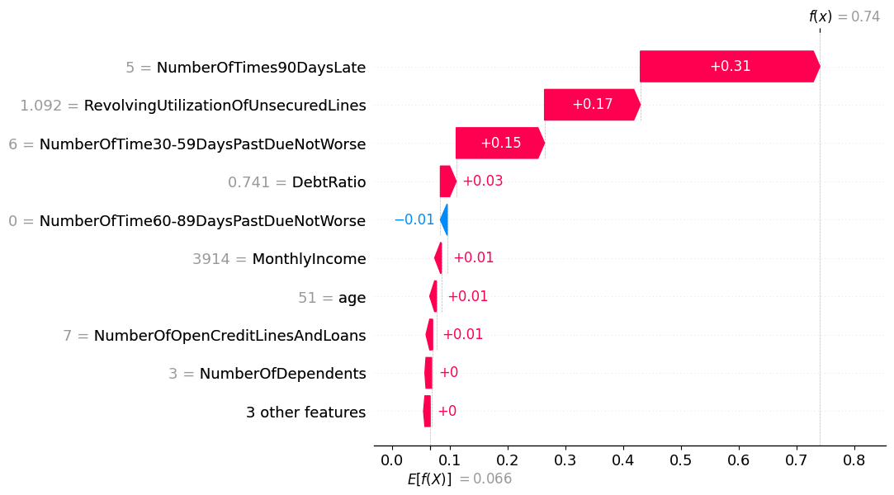
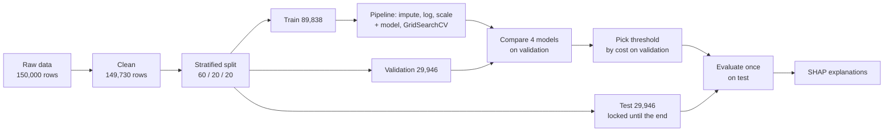

# Explainable Credit-Risk Scorer


**A credit-default model for 150,000 real borrowers where the decision threshold is chosen by business cost, not by the default 0.5, and every flag can be explained.**

On 29,946 untouched test borrowers, it catches **82%** of seriously delinquent borrowers at **63% lower cost than approving everyone** (under an assumed 20:1 cost ratio, with a sensitivity analysis showing how much that assumption matters).

---

## Table of contents

1. [Why this project](#why-this-project)
2. [Headline results](#headline-results)
3. [Visuals](#visuals)
4. [Data and cleaning](#data-and-cleaning)
5. [Approach](#approach)
6. [Results in detail](#results-in-detail)
7. [Explainability](#explainability)
8. [How sensitive is this to the cost assumption?](#how-sensitive-is-this-to-the-cost-assumption)
9. [Key design decisions](#key-design-decisions)
10. [Limitations](#limitations)
11. [Next steps](#next-steps)
12. [Repository structure](#repository-structure)
13. [Reproduce](#reproduce)
14. [Author](#author)

---

## Why this project

Most credit-scoring tutorials stop at "accuracy 93%". That number is meaningless here: only about **6.6%** of borrowers become seriously delinquent, so a model that approves everyone is already "93% accurate" and useless.

A lender actually cares about two different mistakes:

| Mistake | What happens | Assumed cost |
|---|---|---|
| **False negative** | Approve someone who later defaults | 40,000 cost units |
| **False positive** | Flag a safe borrower | 2,000 cost units |

So this project asks the question a lender would ask: **which threshold minimises total cost, how much does it save, and why was each applicant flagged?**

## Headline results

Evaluated **once**, on a held-out test set the model never touched during tuning or threshold selection.

| Strategy | Total cost | Saving vs approve-all |
|---|---|---|
| Approve everyone | 79.0M | 0% |
| Flag everyone | 55.9M | 29% |
| Random Forest at default 0.5 threshold | 69.9M | 12% |
| **Random Forest at cost-chosen threshold (0.050)** | **29.3M** | **63%** |

| Test metric | Value |
|---|---|
| Recall (delinquent borrowers caught) | **0.820** |
| Precision | 0.177 |
| ROC-AUC | 0.857 |
| PR-AUC | 0.391 (a no-skill model scores 0.066) |
| Share of applicants flagged | 31% |

> The default 0.5 threshold would cost **more than flagging everyone**. Choosing the threshold by cost is what turns a mediocre-looking classifier into a useful decision tool.

## Visuals

### Cost versus decision threshold

The cost curve has a sharp minimum at low thresholds and is flat near it. The shaded band marks every threshold within 2% of the cheapest cost. I chose the highest threshold in that band (0.050), which flags fewer applicants for almost the same cost. The dashed line shows what the default 0.5 would cost.



### What drives risk overall (SHAP feature importance)

Utilization of unsecured credit lines, 90+ day late payments and 30–59 day late payments dominate. Income, debt ratio and the missing-value indicators contribute very little.



### How each feature pushes predictions (SHAP beeswarm)

Each dot is one borrower. Red means a high feature value, blue means low. High utilization and high late-payment counts push risk up (red dots to the right). Younger age pushes risk up (blue dots to the right of the age row).



### Explaining a single applicant (SHAP waterfall)

The highest-risk applicant in the sample has a predicted risk of **0.74** against a base rate of 0.066. Five 90+ day late payments add the most (+0.31), followed by 109% credit utilization (+0.17) and six 30–59 day late payments (+0.15). This is the kind of reason-by-reason explanation a loan officer or regulator can read.



## Data and cleaning

**Source:** [Give Me Some Credit](https://www.kaggle.com/c/GiveMeSomeCredit) (Kaggle). 150,000 borrowers, 10 features, target `SeriousDlqin2yrs` (90+ days past due within two years). Please check Kaggle's terms before redistributing; the data is not included in this repository.

I investigated the data before modelling and handled each problem deliberately:

| Problem found | Decision |
|---|---|
| 1 row with age 0 | Removed (impossible value) |
| 269 rows with codes 96/98 in the "90 days late" column | Removed (placeholder codes, not real counts) |
| 371 rows with credit utilization above 2 | Clipped at 2 |
| Extreme `DebtRatio` values | Log-transformed inside the pipeline |
| `MonthlyIncome` missing (about 20%), `NumberOfDependents` missing | Median imputation inside the pipeline plus missing-indicator columns |

After cleaning: **149,730 rows**.

## Approach



1. **One stratified 60/20/20 split** up front. Each part has the same 6.6% positive rate.
2. **Preprocessing lives inside a scikit-learn `Pipeline`**, so imputation and scaling are fitted only on training data (no leakage).
3. **Baselines first:** approve-everyone, flag-everyone and a dummy classifier, so every model is judged against something.
4. **Four models, each tuned with `GridSearchCV`** (3-fold, scored by PR-AUC, which suits imbalanced data): Logistic Regression, Decision Tree, Random Forest, Gradient Boosting.
5. **Model and threshold chosen on the validation set only.**
6. **The test set is opened exactly once**, at the end.

## Results in detail

### Model comparison (validation set)

| Model | Val ROC-AUC | Val PR-AUC | Cheapest threshold | Cost at cheapest |
|---|---|---|---|---|
| **Random Forest** | 0.873 | 0.426 | 0.045 | 27.1M |
| Gradient Boosting | 0.871 | 0.419 | 0.045 | 27.6M |
| Logistic Regression | 0.861 | 0.406 | 0.045 | 29.1M |
| Decision Tree | 0.857 | 0.395 | 0.040 | 28.7M |
| Dummy classifier | 0.500 | 0.066 | n/a | n/a |

Random Forest and Gradient Boosting are within 1.5% of each other on cost, so they are effectively tied. I deployed Random Forest because it had the lowest validation cost, and I report the tie rather than overstating the win.

### Test-set confusion matrix (threshold 0.050)

| | Predicted safe | Predicted risky |
|---|---|---|
| **Actually safe** | 20,429 | 7,541 |
| **Actually delinquent** | 356 | 1,620 |

### Do validation and test agree?

Cost per 1,000 applicants was 915k on validation and 979k on test (+7%). A small rise is expected because the threshold was tuned on validation. The threshold itself was stable: cheapest at 0.045, chosen at 0.050.

## Explainability

SHAP (TreeExplainer) is run on the winning model, after preprocessing, so explanations refer to the original business features. Mean absolute SHAP values, top five:

| Feature | Mean \|SHAP\| |
|---|---|
| RevolvingUtilizationOfUnsecuredLines | 0.0325 |
| NumberOfTimes90DaysLate | 0.0271 |
| NumberOfTime30-59DaysPastDueNotWorse | 0.0206 |
| NumberOfTime60-89DaysPastDueNotWorse | 0.0137 |
| age | 0.0093 |

The ranking matches credit intuition: current stress on credit lines and a history of late payments matter far more than income or household size.

## How sensitive is this to the cost assumption?

The 20:1 cost ratio is an **assumption**, and the best threshold moves with it. I tested it rather than hiding it:

| FN : FP cost ratio | Cheapest threshold | Extra cost if I keep threshold 0.050 |
|---|---|---|
| 5 : 1 | 0.180 | +52% |
| 10 : 1 | 0.120 | +12% |
| **20 : 1 (used)** | **0.045** | **+1%** |
| 40 : 1 | 0.030 | +10% |

A real lender would supply its own costs and re-run the threshold step. The reusable part of this project is the method. I also tabulated thresholds by **review capacity** (for example, "we can manually review 20% of applicants"), because in practice a team's capacity is often the binding constraint.

## Key design decisions

- **Cost-based threshold instead of 0.5.** Default thresholds assume both errors cost the same. They do not.
- **Plateau-aware choice.** The cost curve is flat near its minimum, so I picked the highest threshold within 2% of the cheapest. Fewer flags for almost the same cost.
- **PR-AUC for tuning, not accuracy or ROC-AUC.** With 6.6% positives, PR-AUC reflects performance on the class that matters.
- **No leakage.** One split, preprocessing inside the pipeline, thresholds chosen on validation, test used once.
- **Honest comparison.** Near-ties are reported as near-ties, and the sensitivity to the cost ratio is shown, not hidden.

## Limitations

- **Costs are assumed, not measured.** See the sensitivity table above.
- **Test ROC-AUC (0.857) is a little lower than validation (0.873).** I did not compute confidence intervals; bootstrapping the test set would quantify this.
- **Some grids are narrow.** For Logistic Regression, Decision Tree and Gradient Boosting, the best settings sat at an edge of the search grid. The models are close enough that I would not expect a different conclusion, but a wider search could gain a little.
- **Single historical snapshot.** There is no time dimension, so I cannot test drift or out-of-time performance.
- **Not a production credit system.** Real lending also needs fairness testing, regulatory review, calibration checks and monitoring.

## Next steps

- Bootstrap confidence intervals on the test metrics.
- Probability calibration and calibration curves.
- Fairness audit across age groups.
- Serve the pipeline behind a small API (FastAPI) with a model card.

## Repository structure

```
explainable-credit-risk-scorer/
├── explainable_credit_risk_score.ipynb   # full analysis, run top to bottom
├── README.md
├── .gitignore
└── images/                               # figures used in this README
```

## Reproduce

```bash
git clone https://github.com/<your-username>/explainable-credit-risk-scorer.git
cd explainable-credit-risk-scorer
pip install pandas numpy scikit-learn matplotlib shap jupyter
# place cs-training.csv in this folder, next to the notebook
jupyter notebook explainable_credit_risk_score.ipynb
```

A full run takes roughly 15 minutes, mostly the Random Forest and Gradient Boosting grid searches. If you run it in Google Colab, upload `cs-training.csv` to the session first.

**Stack:** Python, pandas, NumPy, scikit-learn (Pipelines, GridSearchCV), SHAP, matplotlib.

## Author

**Sakshi Deshwal**: aspiring AI/ML engineer.
 [GitHub](https://github.com/Sakshi-Deshwal) · sakshideshwal312@gmail.com
